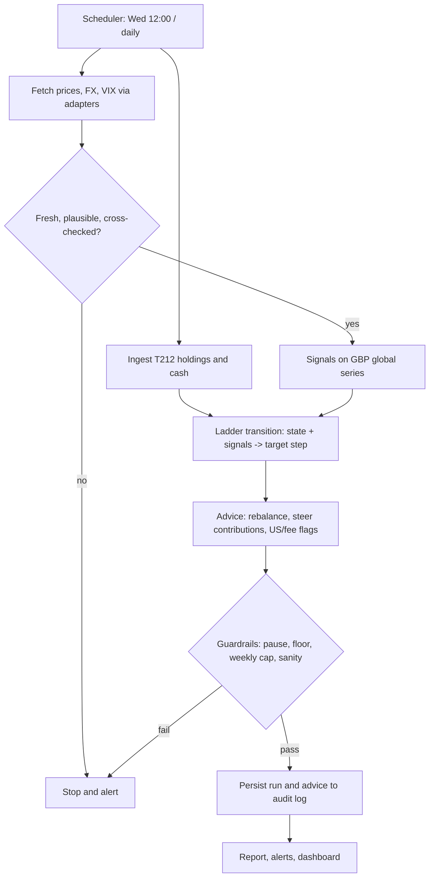
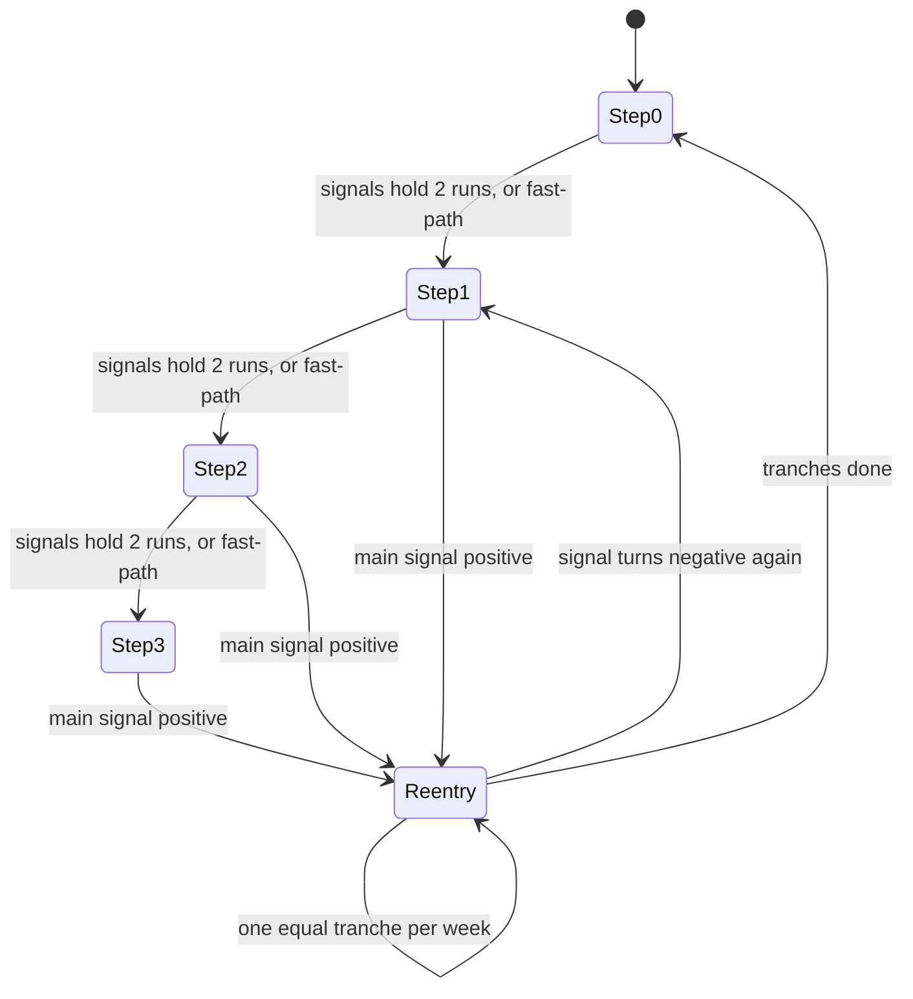

# Portfolio Guard v1 - Plan

**Target repo:** `portfolio/` (new project, no code yet; `git init` is the first act of U1). Sibling `portfolio-compass/` is a copy source, never a dependency.

---

## Goal Capsule

- **Objective:** The owner can see, every week and without watching markets, whether to cut equity risk or step back in, with the exact trades to make, and has evidence from history on how much drawdown that protects against and what it costs in return.
- **Means:** A Python advice-only service on an always-on small host. It runs a trend, drawdown and volatility signal ladder over a GBP global-equity series, backs the rules with a reproducible backtest harness, and reports by Telegram and a web dashboard (KTD1, KTD2, KTD6).
- **Authority:** `PRD.md` "Decided" items are fixed. The PRD's open decisions take the defaults in the Planning Contract and stay marked for owner confirmation. Where research contradicts the PRD (R21), the plan reports it and does not silently change the PRD.
- **Execution profile:** Four PRs (below), merged in order. PR2 ends in a hard gate: backtest results go to the owner before PR3 starts.
- **Stop conditions:** Stop at the Phase 0 gate (U6) and wait for the owner. Stop on any data-integrity or contract question; write it to `docs/queries/` rather than guess.
- **Finishes and ships:** The owner reviews each PR, runs the 3-month paper-trading period (Phase 2), and decides on real use.

---

## Product Contract

### Summary

Portfolio Guard reads the owner's Trading212 holdings weekly (Wednesday 12:00 Europe/London) and daily for crises, evaluates trend, drawdown and volatility on one GBP global-equity series, and advises a step on a 90/10 to 50/50 equity/safe ladder. It also steers new money, flags allocation drift, US concentration and high fees, and compares progress with three benchmarks. v1 is advice-only. Phase 0 builds data, ingestion and a backtester, and the advice engine waits on its results.

### Problem Frame

Buy-and-hold exposes a long-horizon ETF portfolio to deep drawdowns, and global cap-weighted funds are increasingly concentrated in a few US mega-caps. The owner wants crash protection without active trading or constant monitoring, accepting a small return lag. The PRD sets the bar: drawdown within about -15% in 2008, 2020 and 2022, lag no worse than 1% a year over rolling 3+ year windows, then three months of paper trading before real use. Research for this plan found that bar may not be jointly reachable (R21), so the backtest is also the means of finding out.

### Requirements

**Portfolio ingestion**
- R1. Read holdings, cash, account summary, orders, dividends and transactions from the Trading212 API with read-only keys, for the Invest (GIA) and Stocks ISA accounts as separate accounts in one portfolio view (PRD 5.1).
- R2. Every holding carries account and platform labels; remaining InvestEngine holdings can be entered manually until the ISA transfer completes. BRK.B is excluded from tactical changes.
- R3. Store a daily portfolio snapshot from day one, because the API has no valuation history.

**Market data**
- R4. Price and index sources are swappable adapters returning a common format; free sources are the default; unofficial sources are optional, never the sole input, and cross-checked against a second independent source (PRD 5.2).
- R5. Missing, stale or implausible data (a configurable jump threshold) stops the run and alerts rather than guessing.
- R6. Raw and cleaned history is stored locally.

**Signals and ladder**
- R7. Three signals on one global equity index converted to GBP: trend versus a long moving average, drawdown from trailing high, and volatility spike (PRD 5.3).
- R8. A ladder with steps 90/10, 75/25, 60/40, 50/50. A de-risking step needs the signal to hold for 2 consecutive weekly runs, or a fast-path when the index falls 10% in a week.
- R9. Equity is never advised below 50%. A change must shift 5%+ of the portfolio. There is a 2-week cooldown between changes and a maximum change of 15% of the portfolio a week.
- R10. Once the main signal turns positive, return to equities in equal weekly tranches (default 4), exempt from the cooldown.

**Rebalancing and constraints**
- R11. Weekly threshold-band rebalancing (about 5 percentage points); new money is used before selling (PRD 5.5).
- R12. ISA lump sums follow the current ladder step and drift. GIA never gets tactical sells; each £1,000 monthly contribution is steered to the safe or growth side by ladder step.
- R13. The safe asset defaults to a money-market ETF (CSH2; XSTR alternative); other instruments are selectable and comparable in backtests.
- R14. Flag look-through US exposure above a limit and holdings above an ongoing-charge ceiling, and suggest alternatives from an owner-controlled watchlist available on Trading212.

**Backtesting and benchmarks**
- R15. Backtests run on GBP-converted index history with proxies for pre-ETF years, marked clearly, and report CAGR, max drawdown, time to recover, volatility, Sharpe, Sortino, Calmar, turnover, time defensive and whipsaw round trips (PRD 6).
- R16. Backtests sweep cadence, weekday, confirmation length, thresholds and safe assets with few parameters, walk-forward validation and results shown as ranges.
- R17. Every backtest records data versions and parameters and can be reproduced.
- R18. Three built-in benchmarks (current mix buy-and-hold, static 90/10 rebalanced, single global tracker) plus an extensible registry.

**Delivery and safety**
- R19. A weekly report (status light, signals, ladder step, exact trades by ETF/account/amount, allocation versus target, benchmark comparison, drawdown versus the cap), a daily light check, phone alerts without balances, and a web dashboard.
- R20. An audit log stores each run's inputs, signals, step, advice and reasons, and records whether the owner followed, changed or ignored advice. A pause switch halts all advice; guardrails check data and advice sanity.
- R21. Report, per backtest scenario, the drawdown actually achieved, the drawdown the 50% floor alone allows, and the return lag, as a frontier. Do not assume the -15% cap is reachable.

### Key Decisions

- **Separate project that copies from Compass.** (session-settled: user-approved — chosen over a standalone rebuild and over a path dependency on Compass: Compass has no stable API, drags dbt/streamlit/scipy, and is tested on synthetic data only.) Governs R4, R11, R20.
- **Advice-only in v1.** Inherited from the PRD ("Decided"); execution is Phase 3 and out of scope. Governs R1, R20.

### Success Criteria

- Phase 0 produces a backtest report the owner can use to choose parameters, with the R21 frontier for 2008, 2020 and 2022 and rolling 3-year lag versus buy-and-hold.
- A weekly report arrives on schedule in 100% of weeks, or an alert says why not.
- The paper-trading period finishes with no data or logic incidents.
- A rerun of any past advice or backtest reproduces identically (R17).

### Scope Boundaries

**Not built in v1 (PRD):** order execution, tax and CGT reporting, single-stock analysis, leverage, shorting, derivatives, crypto, multi-user.

**Considered and not built:**
- Importing Compass as a library: coupling and instability outweigh the saved copying; revisit only if both projects keep needing the same modules.
- Compass's trend and momentum signals: they are monthly, labelled "not a prediction", and tilt forecasts only; reimplemented as pure functions instead.
- A Telegram command bot for the pause switch: the dashboard carries the pause control in v1; Apprise is send-only. Revisit if the owner wants to pause from the phone.
- Combinatorial purged cross-validation: overkill for a 2-3 parameter rule; plateau checks and walk-forward cover it.

### Deferred to Follow-Up Work

- Phase 3 propose-then-approve execution via the Trading212 API.
- Automatic ISA transfer tracking from InvestEngine (manual entry until transfer completes).

### Open Questions

**Resolve before U7 (blocking, owner decides after the Phase 0 report)**
- The -15% cap versus the 50% floor. With 50% equity, a 30-40% equity fall alone costs 15-20%, so the cap may need a lower floor or a looser cap. The backtest gives the numbers (R21); the owner chooses.
- GIA cannot be sold tactically (R12), so GIA drawdown is cut only by steering new money. Whole-portfolio protection is weaker than the ladder implies. The backtest models this as a variant; the owner should confirm GIA stays sell-free.

**Deferred**
- ISA transfer from InvestEngine: cash or in-specie, and timing, are unconfirmed; ask Trading212 before the transfer, using the official ISA transfer route.
- Notification provider: Telegram plus a fallback is the KTD7/KTD10 default pending owner confirmation; the fallback choice (ntfy or Pushover) can wait for U9.

---

## Planning Contract

### Key Technical Decisions

- KTD1. **Python 3.12, uv, ruff, mypy, pytest** with pytest-socket and hypothesis, mirroring Compass (`portfolio-compass/pyproject.toml`). No live network in tests; a `live` marker for manual runs; golden tests are never edited to make code pass.
- KTD2. **Vendor by copy, not by dependency**, with `docs/provenance.md` listing each copied file, its Compass path and commit `7a2f6de`. Copy leaf modules with few internal imports: `secrets.py`, the T212 `_get` retry and path-allowlist logic, `market/base.py` with the Yahoo, Stooq and Frankfurter providers, the Apprise alert delivery, the APScheduler worker and process lock, and the Docker, OCI and Tailscale ops files. Use Compass only as a reference and re-implement against Guard's own types where the Compass module imports its domain layer: `calc/drift.py` and the cash-flow rebalance stage (they pull in `compass.domain`, `calc/allocation` and the rebalance framework), `replay.py` and the `decision_journal` schema, and the `history.py` splice rule (monthly end to end, so the daily version re-derives the overlap rule). Re-verify every external-facing piece against real services and the T212 demo host. (session-settled: user-approved — chosen over a path dependency on Compass: no stable API and heavy dependencies.)
- KTD3. **Storage split.** DuckDB holds price history, index series and backtest results; SQLite (WAL) holds snapshots, runs, ladder state, audit and overrides. One writer process, guarded by a lock. Only the storage package imports `duckdb` or `sqlite3`. The dashboard's two writes (pause switch, followed/changed/ignored) go through storage actions that take the writer lock for short transactions and wait or retry if the worker holds it; this is the single exception to the dashboard being read-only.
- KTD4. **Pure core.** Signals, ladder transitions, rebalancing, steering and guardrails are pure functions over explicit inputs; I/O lives at the edges. Money uses `Decimal`; vectorised signal code may use float64. Weights are fractions in [0, 1]. The ladder state is an input and an output, never hidden.
- KTD5. **Weekly decisions on completed closes.** The Wednesday 12:00 run uses the latest completed closes; the backtest sweeps all weekdays and the weekday setting is a parameter. Decisions use weekly closes to avoid timezone misalignment across daily closes in different markets.
- KTD6. **Backtest reference series.** MSCI ACWI net total return (USD, manual personal-use download kept as a user file, never committed) divided by FRED `DEXUSUK` for GBP, with ACWI and VT ETFs as a cross-check from 2008 and a documented weaker fallback (S&P 500 total return plus regional proxies) if the MSCI file is unavailable. Proxy periods are tagged per observation. Subtract fund fees so results are not flattered.
- KTD6b. **Live signal series differ from the backtest series.** The Wednesday run builds the GBP global-equity series from a GBP-listed global ETF (VWRP) as primary and a USD global ETF (VT or ACWI) converted with Frankfurter/ECB daily FX as the independent second source; the cross-check in U2 compares them. FRED `DEXUSUK` is for history only, because its publication lag would trip the staleness stop. Each run splices these live closes onto the file-based history at a recorded overlap date, and the manually downloaded MSCI file is refreshed on a schedule the runbook states.
- KTD7. **Alerts through Apprise to Telegram**, with a second channel as dead-man fallback and a weekly heartbeat so silence is detectable. A failed data fetch alerts loudly and never fails quiet. Push text carries no balances.
- KTD8. **Dashboard in Streamlit**, reading a read-only view of the stores, behind Tailscale or a password as in Compass's ops runbooks. It carries the pause switch and the followed/changed/ignored recording.
- KTD9. **Backtest honesty.** Every trial is logged as a plain record of the sweep, parameter results are shown as plateau heatmaps and ranges, and walk-forward out-of-sample curves are the headline (effective sample is about four crises). The harness runs all weekly start offsets to expose timing luck.
- KTD10. **Defaults for the PRD's open decisions**, held in config and flagged for owner confirmation: weekly maximum change 15%; US look-through cap 50%; fee ceiling 0.15%; 4 re-entry tranches; DuckDB plus SQLite; Telegram plus Streamlit. Signal thresholds and the weekday come from the backtest, not from this plan.

### High-Level Technical Design

Run flow, shared by the weekly job, the daily check and the backtester (the backtester replays it over history):



Ladder state machine (directional; the exact transition table is U5's unit-test deliverable):



Every transition is gated by the 5% minimum shift, the 2-week cooldown and the 15% weekly cap; equity never goes below 50%. Re-entry tranches and the carried-over remainder of a capped shift are exempt from the cooldown, and tranches from the minimum shift (U5).

### Output Structure

```text
portfolio/
  pyproject.toml  uv.lock  .python-version  CLAUDE.md  AGENTS.md
  config.defaults/            # all parameters, PRD defaults
  docs/  plans/  provenance.md  queries/  backtests/
  ops/                        # Dockerfile, compose, runbooks (copied)
  src/guard/
    secrets.py  paths.py  config/  storage/
    ingest/                   # t212, manual holdings
    market/                   # base, providers, crosscheck, sanity, history
    signals/  ladder/  advice/  guardrails/
    backtest/                 # engine, metrics, benchmarks, validation, report
    run/                      # weekly, daily, audit, replay
    notify/  ui/  worker/
  tests/{unit,golden,property,integration,fixtures}/
```

### Risks & Dependencies

- Pre-ETF daily GBP history is the largest data risk: no free daily MSCI API exists, ETF history starts after 2008, and the MSCI terms are personal-use. Mitigation: KTD6 file-based truth, cross-checks, and per-observation proxy tags.
- The Trading212 API is beta, has no price or valuation history, and its pence-versus-pounds handling is undocumented. Mitigation: key holdings on ISIN, reconcile position values against account value, snapshot daily, and test on the demo host (U3).
- `yfinance` breaks often and is personal-use only. Mitigation: cache locally, Stooq fallback, never the sole source.
- Compass-derived assumptions (T212 payload shapes, MIC suffix map, LSE pence default, OCI and Tailscale runbooks) are unverified. Mitigation: re-verify each copied piece; do not trust fixtures as truth.
- Trend rules lag V-shaped crashes (2020). Mitigation: daily check and fast-path reduce but do not remove this; the frontier (R21) states it.
- Past performance does not guarantee future results; every report carries the PRD disclaimer, and alert wording is a recommendation, not Compass's "not a call to sell".

### Assumptions

None beyond KTD10's defaults.

---

## Implementation Units

### Unit Index

| U-ID | Title | Key files | Depends on |
|---|---|---|---|
| U1 | Project scaffold and conventions | `pyproject.toml`, `src/guard/config/`, `src/guard/storage/` | none |
| U2 | Market data layer | `src/guard/market/` | U1 |
| U3 | Portfolio ingestion | `src/guard/ingest/` | U1 |
| U4 | Long GBP history builder | `src/guard/market/history.py` | U2 |
| U5 | Signals and ladder (pure) | `src/guard/signals/`, `src/guard/ladder/` | U1 |
| U6 | Backtest harness and Phase 0 report | `src/guard/backtest/` | U4, U5 |
| U7 | Advice, constraints and guardrails | `src/guard/advice/`, `src/guard/guardrails/` | U3, U5, U6 |
| U8 | Run orchestration, audit and replay | `src/guard/run/`, `src/guard/worker/` | U2, U3, U7 |
| U9 | Reports, alerts and dashboard | `src/guard/notify/`, `src/guard/ui/` | U8 |
| U10 | Deployment and paper trading | `ops/`, `docs/runbook.md` | U9 |

### PR1: Foundation and data (Phase 0, part 1)

Waits on: none.

### U1. Project scaffold and conventions

- **Goal:** A runnable, tested skeleton that mirrors Compass tooling and holds every parameter in config.
- **Requirements:** R6, R17, R20; KTD1, KTD2, KTD3, KTD4.
- **Dependencies:** none.
- **Files:** `pyproject.toml`, `.python-version`, `CLAUDE.md`, `AGENTS.md`, `docs/provenance.md`, `config.defaults/*.yaml`, `src/guard/secrets.py`, `src/guard/paths.py`, `src/guard/config/`, `src/guard/storage/`, `tests/unit/test_secrets.py`, `tests/unit/test_config.py`, `tests/unit/test_storage.py`.
- **Approach:**
  1. `git init` in `portfolio/`; set tooling to match Compass (Python 3.12, uv, hatchling, ruff line length 100, mypy strict on core packages, pytest-socket).
  2. Write a `CLAUDE.md` for Guard from the Compass rules that apply (no live network in tests, golden tests not edited to pass, secrets never logged, only `storage` touches the databases, real data directory outside the repo). Use a `GUARD_` env prefix and `guard_` secret names so co-hosting with Compass cannot collide.
  3. Copy `secrets.py`; build layered config (defaults in repo, overrides in the data directory, versioned with a hash) with every PRD parameter and default.
  4. Create the DuckDB and SQLite storage package with the single-writer lock and WAL; ops tables for snapshots, runs, ladder state, advice and an append-only decision journal.
- **Patterns to follow:** `portfolio-compass/src/compass/secrets.py`, `config/store.py`, `storage/ops.py`, `worker/lock.py`.
- **Test scenarios:**
  - A config key missing from overrides resolves to the PRD default; an unknown key raises.
  - A changed config produces a new version hash; the old version stays readable.
  - `get_secret` returns the fake value from the test env and never appears in captured logs.
  - A second writer process fails to acquire the lock.
  - An update or delete on the append-only journal is rejected by the database.
  - A data directory inside the repo is refused.
- **Verification:** pytest, ruff and mypy run clean on the empty skeleton; the provenance file lists every copied file.

### U2. Market data layer

- **Goal:** Swappable price, FX and macro adapters with staleness, jump and cross-source checks that stop a run rather than guess.
- **Requirements:** R4, R5, R6; KTD2, KTD6.
- **Dependencies:** U1.
- **Files:** `src/guard/market/base.py`, `src/guard/market/providers/{yahoo,stooq,fred,frankfurter,msci_file}.py`, `src/guard/market/fetch.py`, `src/guard/market/crosscheck.py`, `src/guard/market/sanity.py`, `tests/unit/market/`, `tests/fixtures/market/`, `tests/integration/market/`.
- **Approach:**
  1. Copy the provider protocol and the Yahoo, Stooq and Frankfurter providers; write a new FRED provider (`DEXUSUK`, `VIXCLS`) and an MSCI user-file loader that never commits the file.
  2. Replace first-provider-wins with a cross-check: a signal input is trusted only when two independent sources agree within a tolerance; the unofficial sources can be a second source, never the only one.
  3. Add staleness (expected last close by calendar, including UK and US holidays) and jump (configurable percent) checks that raise a stop-and-alert error.
  4. Store raw payloads (hashed) and cleaned series in DuckDB.
- **Execution note:** Test-first for the cross-check and sanity rules, which are the PRD's data-safety core.
- **Patterns to follow:** `portfolio-compass/src/compass/market/{base,fetch}.py` and `providers/`.
- **Test scenarios:**
  - Two sources agree within tolerance: the series is accepted and both source ids are recorded.
  - Two sources disagree beyond tolerance: the run stops with an error naming both.
  - Only one source returns data: the series is flagged untrusted and the run stops.
  - A close older than the expected last trading day (given a bank holiday): staleness error; the same age on a holiday gap passes.
  - A 25% one-day jump with a 15% threshold: stop; a 14% jump passes.
  - FRED returns holiday NaNs: forward-filled and flagged, not dropped.
  - Provider HTTP 429 or timeout: falls through to the next source and is logged without secrets.
  - Integration (marked `live`, not in CI): each real provider returns a recent close for a known ETF.
- **Verification:** the run-stopping errors carry the failing source and rule; no test uses the network.

### U3. Portfolio ingestion

- **Goal:** A read-only Trading212 ingestion plus manual holdings, giving one portfolio view with daily snapshots.
- **Requirements:** R1, R2, R3; KTD2.
- **Dependencies:** U1.
- **Files:** `src/guard/ingest/t212.py`, `src/guard/ingest/manual.py`, `src/guard/ingest/model.py`, `tests/unit/ingest/`, `tests/fixtures/t212/`, `tests/integration/ingest/`, `docs/queries/`.
- **Approach:**
  1. Copy the GET-only allowlist, backoff and cursor-pagination logic (follow `nextPagePath` until null; page size 50); authenticate with HTTP Basic per the current docs; read the rate-limit headers.
  2. One configured key per account (Invest, ISA), each labelled; the base URL is configurable so the demo host serves integration testing.
  3. Resolve instruments to ISIN through the instruments endpoint and key holdings on ISIN, not T212 ticker. Normalise pence-quoted (GBX) London lines using instrument currency, and reconcile summed position values with the account total; a mismatch beyond tolerance stops the run (R5).
  4. A manual-holdings file with platform labels for remaining InvestEngine positions; a configured fixed-satellite list (BRK.B) marked excluded.
  5. Write a snapshot (holdings, cash, total, timestamp) to SQLite every day.
  6. Fetch orders, dividends and transactions through the same GET-only, cursor-paginated client and store them raw in SQLite (R1).
  7. Add a minimal scheduled daily snapshot job (one APScheduler entry run by a small worker) so history accumulates from the day U3 merges, running on the owner's machine until U10 moves it to the host. The snapshot data cannot be recovered later.
- **Patterns to follow:** `portfolio-compass/src/compass/ingest/adapters/t212_api.py`, `t212_common.py`.
- **Test scenarios:**
  - A two-page positions response is merged into one holdings list.
  - A 429 with `Retry-After` is honoured, and the request succeeds on retry.
  - A GBX-quoted position is normalised so quantity times price matches the account value.
  - Position values that disagree with the account total by more than tolerance raise a stop error.
  - ISA and GIA holdings of the same ETF remain separate lines with account labels and combine in the portfolio view.
  - BRK.B appears in holdings but is excluded from the tactical base.
  - Manual InvestEngine rows load with platform "investengine".
  - Two snapshots on one day: the second replaces the first (idempotent).
  - The snapshot job fires once per day at its scheduled time and a missed day is recorded as a gap, not backfilled with guessed values.
  - Two-page orders, dividends and transactions responses are each merged and stored; re-fetching stores no duplicates.
  - Integration (demo host, `live`): fetch positions and cash for a demo account without a write permission.
- **Verification:** no code path issues anything but GET; a key with trading scopes disabled is the documented setup.

### U4. Long GBP history builder

- **Goal:** Weekly and daily GBP series for the global index, ETFs and safe assets going back through 2000-2008, with each observation tagged by source and proxy status.
- **Requirements:** R6, R15, R17; KTD6.
- **Dependencies:** U2.
- **Files:** `src/guard/market/history.py`, `config.defaults/history_sources.yaml`, `tests/unit/market/test_history.py`, `tests/golden/history/`, `docs/provenance.md`.
- **Approach:**
  1. Copy the splice and provenance algorithm (older series rebased to newer at the first overlap, no return created at the splice) and extend it from monthly to daily with weekly resampling.
  2. Per asset, define a priority chain: global equity (MSCI ACWI net TR in GBP, then ACWI/VT, then VWRP, with the S&P 500 total return plus regional proxies composite as the last, proxy-tagged fallback when the MSCI file is absent), S&P 500 (S&P 500 total return), Europe, money market (SONIA, then Bank Rate before 1997), short gilts (yield-curve derived), gold (GBP). Convert USD series with `DEXUSUK`.
  3. Deduct typical fund fees from index series so proxy periods match what can be bought. Tag every observation `index`, `etf` or `proxy`.
  4. Record data-set versions (file hashes, fetch dates) for reproducibility.
- **Patterns to follow:** `portfolio-compass/src/compass/market/history.py`.
- **Test scenarios:**
  - Splicing a proxy onto an ETF series at the first overlap leaves no discontinuity in returns at the join.
  - A USD index divided by a GBP/USD series gives the hand-computed GBP return on a three-point example.
  - Every observation before the ETF's launch carries a `proxy` tag; after it, `etf`.
  - Weekly resample takes the last close on or before the decision weekday.
  - A gap longer than a threshold in a series raises rather than interpolates silently.
  - With the MSCI file absent, the global-equity chain reaches the S&P 500 plus regional composite and tags every observation `proxy`.
  - Golden: the 2008-2009 GBP series for the reference index matches a stored, independently checked snapshot.
- **Verification:** a data-versions manifest is produced and a second build from the same inputs is byte-identical.

### PR2: Signals, ladder and backtest (Phase 0, part 2)

Waits on: PR1 (needed before this group can start: U6 uses U4's history and U1's storage).

### U5. Signals and ladder (pure)

- **Goal:** Pure signal functions and a ladder state machine that implement the PRD's rules exactly.
- **Requirements:** R7, R8, R9, R10; KTD4, KTD5, KTD10.
- **Dependencies:** U1.
- **Files:** `src/guard/signals/{trend,drawdown,volatility}.py`, `src/guard/ladder/{state,transition}.py`, `tests/unit/{signals,ladder}/`, `tests/property/ladder/`, `tests/golden/ladder/`.
- **Approach:**
  1. Implement trend (price versus a long moving average; candidates 10-month and 200-day), drawdown from trailing high, and volatility (VIX-style or realised) as pure functions that return a value, a boolean and a data-gap marker, never inventing data.
  2. The ladder transition takes the state (step, pending confirmations, last-change week, re-entry tranches remaining) plus the week's signals and returns the new state and the target equity weight. Default mapping: step equals the number of negative signals (0-3), fast-path may jump higher; the mapping is configuration.
  3. Apply in order: confirmation (2 runs) or fast-path, then the 5% minimum shift, 2-week cooldown (tranches exempt), 15% weekly cap and the 50% floor. When the cap truncates a shift, the remainder is stored in the ladder state as a pending shift and continues each following week without a new cooldown or confirmation, like a re-entry tranche; a new signal change replaces it. This reading is a plan decision for the owner to confirm at the Phase 0 gate.
  4. Re-entry starts when the main signal (trend) is positive and moves equal weekly tranches, exempt from both the cooldown and the 5% minimum shift (a 4-tranche return from Step 1 is 3.75 points a week); a new negative signal during re-entry cancels it.
- **Execution note:** Test-first. Hand-worked weekly sequences are the specification; property tests assert invariants.
- **Test scenarios:**
  - One negative signal for a single week: no change; the same signal in two consecutive weeks: step 1 recommended.
  - A -10% index week needing a 40-point shift: 15 points that week, then the remaining 25 as pending shifts of 15 and 10 in the next two weeks, despite the cooldown.
  - A new, different signal change while a pending shift exists replaces the pending shift.
  - A change attempted one week after the last change is held by the cooldown; the same change after two weeks proceeds.
  - A computed shift of 4% is suppressed; 5% proceeds.
  - Re-entry with 4 tranches yields four equal weekly buys even inside the cooldown window.
  - Re-entry from Step 1 (75%) to 90% yields four tranches of 3.75 points despite the 5% minimum shift.
  - A negative signal in tranche 2 cancels the remaining tranches and returns to the signal-driven step.
  - Property: advised equity never falls below 50%, never changes by more than 15 points in a week, and the same inputs always yield the same state.
  - Missing price data yields a data-gap marker and no recommendation.
  - Golden: a stored 20-week sequence gives the expected step history.
- **Verification:** every rule in R8-R10 appears as a named unit test.

### U6. Backtest harness and Phase 0 report

- **Goal:** A reproducible backtester that replays the run flow over history and produces the evidence the owner needs to decide parameters, floor and cap.
- **Requirements:** R15, R16, R17, R18, R21; KTD5, KTD6, KTD9.
- **Dependencies:** U4, U5.
- **Files:** `src/guard/backtest/{engine,costs,metrics,benchmarks,sweep,validation,report}.py`, `config.defaults/benchmarks.yaml`, `tests/unit/backtest/`, `tests/golden/backtest/`, `tests/property/backtest/`, `docs/backtests/phase0-report.md`.
- **Approach:**
  1. The engine replays weekly decisions through U5 against the history from U4, applying the advised equity weight each week to a two-asset (equity, safe) portfolio, with spread costs and no ISA commission; FX charges apply to non-GBP lines only where modelled.
  2. Two portfolio modes: full ladder everywhere, and the realistic mode in which GIA balances move only through new contributions (Open Questions).
  3. Metrics: CAGR, max drawdown, time to recover, volatility, Sharpe, Sortino, Calmar, turnover, time defensive, whipsaw round trips (reversal within four weeks).
  4. Benchmarks: current mix buy-and-hold, static 90/10 rebalanced, single global tracker; a registry for additions.
  5. Sweeps over cadence (weekly versus monthly), all weekdays and all weekly start offsets, confirmation length, thresholds, and safe assets (money market, short gilts, gold). Plateau heatmaps, anchored walk-forward, and a log of every trial.
  6. For 2008, 2020 and 2022 report achieved drawdown, floor-only drawdown and return lag as a frontier (R21), and rolling 3-year lag.
  7. Each run writes a manifest: code version, config hash, data versions, parameters, seed.
- **Execution note:** Golden tests with independently hand-computed expectations for the engine and metrics; a frozen harness result is never edited to pass.
- **Test scenarios:**
  - A constant-equity strategy reproduces buy-and-hold exactly, to the cent.
  - A hand-computed 10-week example (known prices, a step change in week 4) gives the expected weights and value.
  - Max drawdown, time to recover and Sortino match hand-worked values on a short series.
  - A whipsaw (de-risk then re-risk within four weeks) is counted once.
  - Costs: a 0.1% spread on a 20% shift reduces value by the hand-computed amount.
  - The realistic mode leaves existing GIA balances unchanged on a de-risk step and applies the step only to the ISA and new contributions.
  - Two runs with identical inputs give an identical manifest and result; a changed data version changes the manifest.
  - Proxy-period observations are marked in the output and excluded from the "ETF-era only" metric view.
  - The sweep never reports a single best set: it outputs a plateau and range per metric.
- **Verification:** `docs/backtests/phase0-report.md` shows the R21 frontier, the plateau charts, proxy periods, the weekday result for Wednesday, and the answers to Open Questions 1 and 2. **Gate: send to the owner; do not start PR3 until the owner has chosen floor, cap, parameters and GIA policy.**

### PR3: Advice engine (Phase 1, part 1)

Waits on: PR2 (merge order, plus the owner's gate decision before this group starts).

### U7. Advice, constraints and guardrails

- **Goal:** From a ladder target and the current holdings, produce exact trades and flags, and refuse unsafe advice.
- **Requirements:** R9, R11, R12, R13, R14, R20; KTD2, KTD4, KTD10.
- **Dependencies:** U3, U5, U6.
- **Files:** `src/guard/advice/{drift,rebalance,steer,constraints,watchlist}.py`, `src/guard/guardrails/{checks,pause}.py`, `config.defaults/{targets,watchlist}.yaml`, `tests/unit/{advice,guardrails}/`, `tests/golden/advice/`, `tests/property/advice/`.
- **Approach:**
  1. Copy the drift and bands logic and the cash-flow rebalance stage; drop the tax and sale-to-GIA stages. New money is allocated first; ISA changes may sell; GIA gets no sells.
  2. Steering: each £1,000 monthly GIA contribution and ISA lump sum goes to the safe or growth side per ladder step and drift.
  3. Exclude fixed satellites (BRK.B) from tactical totals.
  4. Flag look-through US exposure above the cap (from per-ETF region weights held in config with a source and date) and holdings above the fee ceiling, suggesting watchlist alternatives available on Trading212 (seeds CUKX, VMID, XDEW).
  5. Guardrails: the pause switch blocks all advice; equity floor; maximum weekly change; advice versus holdings sanity (trade sizes cannot exceed holdings or cash); data sanity from U2 and U3. Any failure produces a "no advice, here is why" result.
- **Test scenarios:**
  - A 5.1-point drift past a 5-point band yields a rebalance; exactly 5.0 does not.
  - A £1,000 contribution at step 2 goes to the safe side in the stated proportion; at step 0 it goes to growth.
  - A de-risk step is expressed as ISA sells plus GIA contribution steering, with no GIA sell line.
  - Property: no advice sells more than held, spends more than available cash, or leaves equity below the floor.
  - Pause on: output is a "paused" result with no trades.
  - US exposure at 52% against a 50% cap yields a flag naming the contributing holdings.
  - A holding at 0.22% against a 0.15% ceiling yields a flag and a watchlist alternative only if flagged available on Trading212.
  - BRK.B never appears in a trade line.
  - Golden: a stored holdings snapshot and target yield the expected trade list.
- **Verification:** no unguarded path from the advice builder to output.

### U8. Run orchestration, audit and replay

- **Goal:** The weekly and daily jobs end to end, with a complete audit trail that replays identically.
- **Requirements:** R5, R17, R19, R20; KTD2, KTD3, KTD5.
- **Dependencies:** U2, U3, U7.
- **Files:** `src/guard/run/{weekly,daily,audit,replay}.py`, `src/guard/worker/{schedule,runner}.py`, `tests/unit/run/`, `tests/integration/run/`, `tests/golden/run/`.
- **Approach:**
  1. Weekly job (Wed 12:00 Europe/London) and daily light check on an APScheduler cron with the London time zone; both are idempotent per scheduled slot and write "last successful run".
  2. The run flow in the High-Level Technical Design; any stop-and-alert error short-circuits to an alert and still records a run row.
  3. Store each run's inputs, signals, ladder state before and after, advice and reasons as canonical JSON with an inputs hash; copy the replay mechanism so a past run can be recomputed and compared.
  4. Record the owner's response (followed, changed, ignored, with a note) in the append-only journal.
  5. Daily check: alert only on -5% in a day, -8% in a week, or a volatility spike, state whether the fast-path applies, and never trade.
- **Test scenarios:**
  - A weekly run at a daylight-saving change fires at 12:00 local time on the Wednesday.
  - Running the same slot twice produces one run row and one advice set.
  - A stale-data stop produces an alert and a run row with status "stopped" and the reason.
  - Replaying a stored run reproduces identical output; changing the code version reports "code_changed".
  - The owner response is stored with the advice id and cannot be edited afterwards, only superseded.
  - The daily check on a -5.1% day alerts and states fast-path status; on -4.9% it stays silent.
  - A market holiday on the scheduled day shifts the evaluation to the latest completed close without error.
- **Verification:** an end-to-end run on fixtures produces advice, an audit row and a replay-identical result.

### PR4: Delivery and operations (Phase 1 finish, Phase 2)

Waits on: PR3 (merge order).

### U9. Reports, alerts and dashboard

- **Goal:** The owner receives the weekly report on the phone and sees detail on the dashboard.
- **Requirements:** R19, R20; KTD7, KTD8.
- **Dependencies:** U8.
- **Files:** `src/guard/notify/{apprise_send,render,heartbeat}.py`, `src/guard/ui/` (Streamlit pages: status, advice, allocation, benchmarks, backtests, audit, controls), `tests/unit/notify/`, `tests/unit/ui/`, `config.defaults/alerts.yaml`.
- **Approach:**
  1. Copy Apprise delivery and redaction; configure the Telegram URL as a secret; add a second fallback channel and a weekly heartbeat; push text contains the status light, step and "see dashboard", never balances or account names.
  2. Weekly report content per R19, including the PRD disclaimer, with alert wording as a recommendation.
  3. Dashboard reads the stores read-only apart from two controls: the pause switch and followed/changed/ignored recording. It shows last successful run, status, backtest pages and proxy tags.
  4. Verify Telegram delivery end to end (Compass never tested it) and the first `/start` handshake in the runbook.
- **Test scenarios:**
  - Rendered push text contains no digits matching holdings values or account names (property test over fixtures).
  - A failed primary channel falls back to the second channel and records both attempts.
  - A missing weekly heartbeat is detectable from the "last successful run" shown on the dashboard.
  - The report lists trades as ETF, account and amount, with the monthly GIA contribution direction.
  - The pause control writes a state that U7 reads on the next run.
  - A dashboard write while the worker holds the writer lock waits or retries and then succeeds, rather than failing.
  - Import-lint: UI modules import only the read API and actions.
- **Verification:** one real test message reaches the phone from a non-production bot (`live`, manual).

### U10. Deployment and paper trading

- **Goal:** Guard runs always-on on a small host and the three-month paper-trading period is tracked.
- **Requirements:** R19, R20; Success Criteria.
- **Dependencies:** U9.
- **Files:** `ops/Dockerfile`, `ops/docker-compose*.yml`, `ops/{deploy,tailscale,backup}.md`, `docs/runbook.md`, `tests/unit/ops/`.
- **Approach:**
  1. Copy the Docker, OCI, Tailscale and backup files with renamed prefixes; keep services bound to loopback with access over Tailscale (or password) as in Compass.
  2. Store the Trading212 keys (read-only, IP-restricted to the host) and the Telegram token in the host secret store.
  3. Run the runbook steps Compass left unexecuted: verify every command flag, restore drill, and key restriction; record results.
  4. Paper-trading log: the audit journal plus a weekly "what I would have done" note; incidents recorded as data or logic.
- **Execution note:** Prefer install and runtime smoke checks over unit coverage; the runbook is the deliverable.
- **Test scenarios:**
  - Test expectation: a unit test fails if any compose service publishes a non-loopback port.
  - Test expectation: a unit test fails if a secret value appears in the image build context.
- **Verification:** a fresh host reaches a first green weekly report from the runbook alone; a restore drill passes.

---

## Verification Contract

| Gate | Command (from `portfolio/`) | Applies to |
|---|---|---|
| Unit and golden tests | `uv run pytest -m "not live and not perf" --ignore=tests/integration` | all units |
| Integration (one directory per invocation) | `uv run pytest tests/integration/<dir>` | U2, U3, U8 |
| Lint | `uv run ruff check src tests` | all units |
| Types | `uv run mypy src/guard` | all units |
| Live checks, manual only | `uv run pytest -m live` | U2, U3, U9 |
| Phase 0 gate | `docs/backtests/phase0-report.md` reviewed by the owner | U6 |

## Definition of Done

- **Global:** pytest, ruff and mypy are clean; no test touches the network; every external-facing copied piece is re-verified or logged in `docs/queries/`; all parameters live in config; abandoned-attempt code is removed from the diff; `docs/provenance.md` lists every copied file.
- **U1-U4:** the skeleton, adapters, ingestion and history build reproducibly, and a rebuild from the same inputs is identical.
- **U5-U6:** every R8-R10 rule has a named test; the Phase 0 report exists and the owner has answered the two blocking questions.
- **U7-U8:** a fixture run yields advice, an audit row and a replay-identical result; the pause switch halts advice.
- **U9-U10:** a real alert reaches the phone; the host runs from the runbook; paper trading has started with the log in place.

---

## Sources & Research

- `PRD.md` (origin; "Decided" items are fixed).
- Compass reuse map and conflicts: `portfolio-compass/CLAUDE.md`, `CONTRACTS.md`, `src/compass/` modules named in KTD2; Compass monthly trend signals are not reused (`src/compass/forecast/signals/`).
- Trading212 API (beta): https://docs.trading212.com/api (auth, rate limits, pagination, no valuation history).
- Trend-rule evidence: Faber 2007 (SSRN 962461); single-asset 10-month rule results are sample dependent (about -15% max drawdown for S&P 500 since 1995 on a monthly rule, from secondary sources).
- Overfitting controls: plateau checks and walk-forward; a deflated-Sharpe adjustment (SSRN 2460551) was considered and not built because those controls and the PRD's ranges already cover it, and about four crises make it weakly meaningful.
- Data: FRED `DEXUSUK` and `VIXCLS`; MSCI end-of-day data (personal-use download); Bank of England SONIA and yield curves.
- Feasibility arithmetic behind R21 is derived, not sourced: with a 50% equity floor, drawdown is at least half the equity drawdown.
- The market-data PRD in the sibling `market-data/` project is a possible optional price adapter (unofficial, ToS-gray, cross-check required); not planned in v1.
